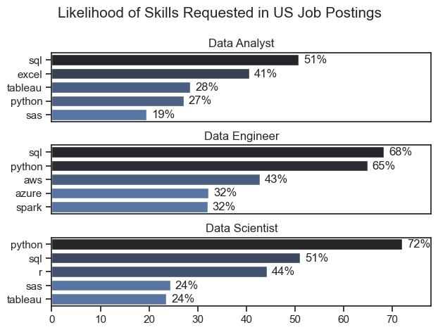
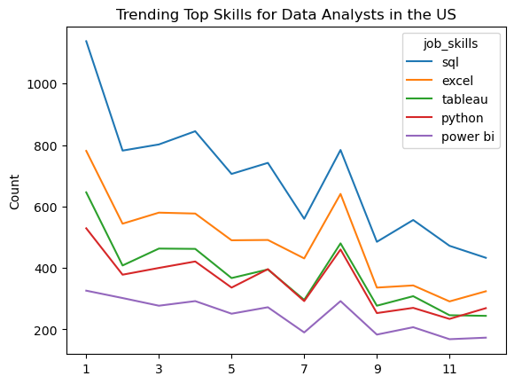
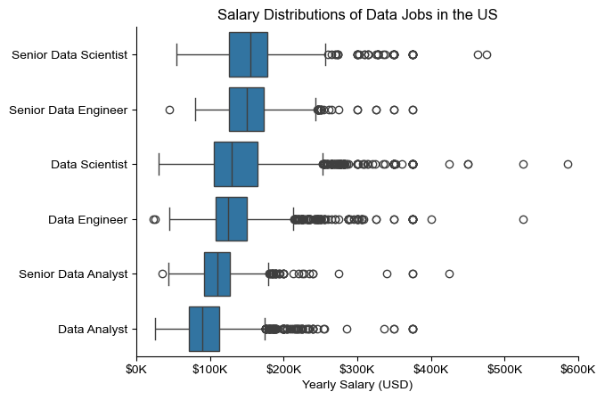
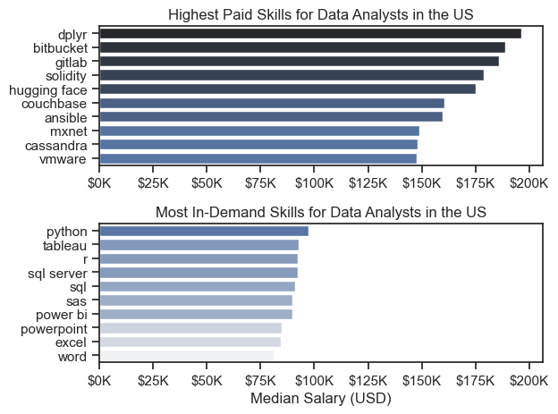
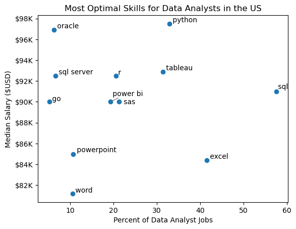
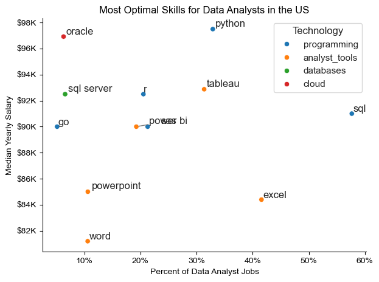

# Market Insights — Data Analysis Skills & Salaries

Exploratory data analysis of the US data job market using Python, Pandas, Matplotlib, Seaborn, and the `lukebarousse/data_jobs` dataset.

## Notebooks

| Notebook | Focus |
| :--- | :--- |
| [1_EDA_Intro.ipynb](1_EDA_Intro.ipynb) | Dataset cleaning, role counts, and exploratory overview |
| [2_Skill_Demand.ipynb](2_Skill_Demand.ipynb) | Most frequently requested skills across Data Analyst, Data Scientist, and Data Engineer roles |
| [3_Skills_Trend.ipynb](3_Skills_Trend.ipynb) | Month-over-month skill demand trends across 2023 |
| [4_Salary_Analysis.ipynb](4_Salary_Analysis.ipynb) | Salary distributions by role and top-paying individual skills |
| [5_Optimal_Skills.ipynb](5_Optimal_Skills.ipynb) | Demand vs. median salary trade-off for Data Analysts |

---

## Project Summary

Welcome to my exploration of the data analytics job market. This project was created to better understand career opportunities in the field by analyzing the most valuable and in-demand skills for data professionals. The goal is to help aspiring and current data analysts identify which skills can lead to stronger career prospects and higher salaries.

---

## Main Questions Explored

This analysis focuses on answering four key questions:

1. Which skills are most commonly requested across the top three data-related job roles?
2. How did demand for Data Analyst skills evolve during 2023?
3. How do salaries differ between data roles and individual technical skills?
4. Which skills provide the best combination of strong demand and high salary potential for Data Analysts?

---

## Tools & Technologies Used

The following technologies were used throughout the project:

- **Python** — Used for data analysis and visualization with libraries such as Pandas, Matplotlib, and Seaborn.
- **Jupyter Notebooks** — Helped organize the workflow, run analysis, and document findings.
- **Visual Studio Code** — Served as the primary coding environment.
- **Git & GitHub** — Used for version control and sharing the completed project.

---

## Data Preparation

This stage focused on importing, cleaning, and preparing the raw dataset for analysis.

### Importing & Cleaning Data

The dataset was loaded and transformed into a usable format by standardizing date fields and converting skill lists into arrays.

```python
# Importing Libraries
import ast
import pandas as pd
import seaborn as sns
from datasets import load_dataset
import matplotlib.pyplot as plt  

# Loading Data
dataset = load_dataset('lukebarousse/data_jobs')
df = dataset['train'].to_pandas()

# Data Cleanup
df['job_posted_date'] = pd.to_datetime(df['job_posted_date'])
df['job_skills'] = df['job_skills'].apply(lambda x: ast.literal_eval(x) if pd.notna(x) else x)
```

### Filtering by Location

To keep the analysis aligned with my target market, the dataset was filtered to include only job postings from the United States.

```python
df_US = df[df['job_country'] == 'United States']
```

---

## Project Analysis

The project is divided into multiple Jupyter notebooks, with each notebook addressing a specific research question.

## 1. Most In-Demand Skills for Popular Data Roles

To determine which skills employers prioritize most, I identified the three most common data job titles and analyzed the top five skills associated with each role. This helps highlight the most important technologies to learn for different career paths.

**Notebook:** `2_Skill_Demand.ipynb`

### Visualization

```python
fig, ax = plt.subplots(len(job_titles), 1)

for i, job_title in enumerate(job_titles):
    df_plot = df_skills_perc[df_skills_perc['job_title_short'] == job_title].head(5)[::-1]
    sns.barplot(data=df_plot, x='skill_percent', y='job_skills', ax=ax[i], hue='skill_count', palette='dark:b_r')

plt.show()
```


### Key Insights

- **Role-Specific Trends:** SQL appears most frequently in Data Analyst and Data Scientist roles, while Python dominates Data Engineer postings.
- **Specialized Engineering Skills:** Data Engineers are often expected to work with platforms such as AWS, Azure, and Spark, whereas Analysts and Scientists rely more heavily on tools like Excel and Tableau.
- **Python’s Broad Value:** Python remains one of the most versatile and valuable skills across all major data roles.

---

## 2. Data Analyst Skill Trends in 2023

To track changing market demands, I analyzed monthly Data Analyst job postings throughout 2023 and monitored how demand shifted for the top five skills.

**Notebook:** `3_Skills_Trend.ipynb`

### Visualization

```python
from matplotlib.ticker import PercentFormatter

df_plot = df_DA_US_percent.iloc[:, :5]
sns.lineplot(data=df_plot, dashes=False, legend='full', palette='tab10')

plt.gca().yaxis.set_major_formatter(PercentFormatter(decimals=0))

plt.show()
```
 

### Key Insights

- **SQL Remains Dominant:** SQL consistently stayed at the top despite a slight decline over time.
- **Excel’s Late-Year Growth:** Excel demand increased significantly toward the end of 2023, eventually surpassing Python and Tableau.
- **Stable Core Skills:** Python and Tableau maintained steady demand throughout the year, while Power BI showed gradual growth.

---

## 3. Salary Analysis Across Roles and Skills

To better understand compensation trends, I examined salary distributions for major U.S. data roles and compared the earning potential of different Data Analyst skills.

**Notebook:** `4_Salary_Analysis.ipynb`

### Salary Distribution Visualization

```python
sns.boxplot(data=df_US_top6, x='salary_year_avg', y='job_title_short', order=job_order)

ticks_x = plt.FuncFormatter(lambda y, pos: f'${int(y/1000)}K')
plt.gca().xaxis.set_major_formatter(ticks_x)
plt.show()
```
  

### Key Insights

- **Higher Seniority, Higher Pay:** Senior Data Scientists and Senior Data Engineers earn the highest salaries, with some roles reaching exceptionally high compensation levels.
- **More Consistent Analyst Salaries:** Data Analyst salaries tend to be more stable and less extreme compared to engineering and data science roles.

### Skill Salary vs. Demand Visualization

```python
fig, ax = plt.subplots(2, 1)  

# Top 10 Highest Paid Skills for Data Analysts
sns.barplot(data=df_DA_top_pay, x='median', y=df_DA_top_pay.index, hue='median', ax=ax[0], palette='dark:b_r')

# Top 10 Most In-Demand Skills for Data Analysts
sns.barplot(data=df_DA_skills, x='median', y=df_DA_skills.index, hue='median', ax=ax[1], palette='light:b')

plt.show()
```


### Key Insights

- **Specialized Skills Earn More:** Tools such as dplyr, Bitbucket, and GitLab are associated with some of the highest salaries.
- **Foundational Skills Drive Hiring:** Excel, SQL, and PowerPoint appear far more frequently in job postings, even though they offer lower median salaries.
- **Balanced Skill Development:** Combining foundational business tools with specialized technical skills can maximize both employability and earning potential.

---

## 4. Finding the Most Valuable Data Analyst Skills

To identify the most strategic skills to learn, I compared skill demand percentages against median salaries to locate skills offering both strong demand and competitive pay.

**Notebook:** `5_Optimal_Skills.ipynb`

### Visualization

```python
from adjustText import adjust_text
import matplotlib.pyplot as plt

plt.scatter(df_DA_skills_high_demand['skill_percent'], df_DA_skills_high_demand['median_salary'])
plt.show()
```
 
### Key Insights

- **Database Expertise Pays Well:** Oracle skills command high salaries despite appearing in fewer job postings.
- **Best Overall Balance:** Python, Tableau, and SQL Server provide an excellent combination of market demand and salary potential.

### Technology Category Analysis

```python
from matplotlib.ticker import PercentFormatter

scatter = sns.scatterplot(
    data=df_DA_skills_tech_high_demand,
    x='skill_percent',
    y='median_salary',
    hue='technology',
    palette='bright',
    legend='full'
)
plt.show()
```

### Key Insights

- **Programming Skills:** Coding-related tools consistently align with higher salary ranges.
- **Database Technologies:** Database platforms like Oracle and SQL Server remain highly valuable in the market.
- **Visualization Tools:** Tableau and Power BI continue to be essential tools with strong demand across the analytics industry.

---

## Major Learnings

This project was both a technical learning experience and an industry-focused research exercise.

- **Improved Python Skills:** I strengthened my ability to work with Pandas, Matplotlib, and Seaborn for data cleaning and visualization.
- **Importance of Data Cleaning:** The project reinforced how critical proper data preparation is before drawing conclusions.
- **Career Planning Through Data:** The analysis showed a strong relationship between specialized technical skills and higher salaries, providing useful direction for long-term career development.

---

## Challenges Faced

- **Handling Unstructured Data:** Cleaning missing values and inconsistent formatting required careful preprocessing.
- **Building Effective Visualizations:** Designing charts that clearly communicated insights involved multiple rounds of experimentation.
- **Maintaining Focus:** It was important to balance curiosity-driven exploration with the project’s original objectives.

---

## Final Thoughts

The data analytics job market continues to evolve rapidly. While core tools like SQL and Excel remain essential for entering the field, higher-paying opportunities increasingly favor professionals with programming expertise and advanced database knowledge. This project offers a practical roadmap for anyone looking to strategically develop their skills in data analytics while also serving as an important milestone in my own learning journey.
